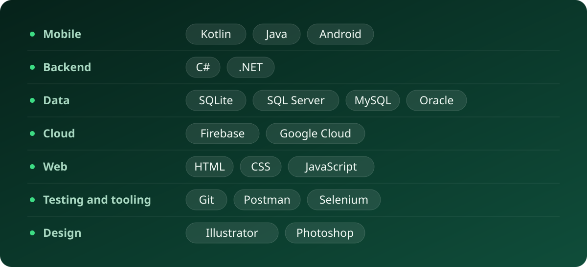

**Software engineer.** I build native Android apps in Kotlin and Java. Mobile is where I spend most of my time; I also work in C# and .NET.

## What I work on

- **Mobile apps.** Native Android, from the interface down to on-device storage.
- **Services and data.** The .NET code and SQL databases that sit behind an app.
- **Cloud.** Firebase and Google Cloud for the parts that run off the device.

## Toolbox

## Get in touch

Ask me about mobile development.

- Email: [jgwarix@gmail.com](mailto:jgwarix@gmail.com)
- LinkedIn: [linkedin.com/in/josephgwara](https://linkedin.com/in/josephgwara)
